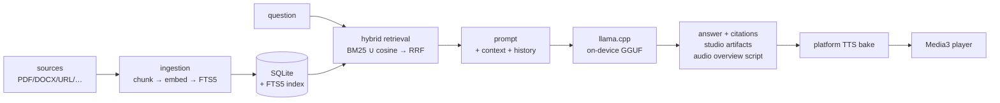

<div align="center">


# PocketNotebook

**A local-first, on-device clone of Google NotebookLM for Android.**

Add sources, chat with citations, and generate audio overviews, reports, mind
maps, flashcards and quizzes — **100% offline on your phone**.

[](https://github.com/touhidsiddiqueeraj-bit/pocketnotebook/actions/workflows/android-ci.yml)
[](https://github.com/touhidsiddiqueeraj-bit/pocketnotebook/actions/workflows/release.yml)
[](https://github.com/touhidsiddiqueeraj-bit/pocketnotebook/releases/latest)

[](LICENSE)

No account. No cloud. No telemetry. The only network traffic is what you ask
for — model downloads and web-page sources.

</div>

## Install

1. Grab **one** APK from the
   [latest release](https://github.com/touhidsiddiqueeraj-bit/pocketnotebook/releases/latest):

   | APK | Engine | Pick this when |
   |---|---|---|
   | `PocketNotebook-…-arm64.apk` | CPU — loads on **every** device | default choice |
   | `PocketNotebook-…-arm64-gpu.apk` | OpenCL/Adreno GPU **+ CPU fallback** | Snapdragon device, want max speed |

2. Sideload it (allow *"install unknown apps"*). Both APKs share one
   signature — they install right over each other.
3. On first launch the app downloads its models once (~1 GB):
   **LFM3-1.7B** (chat, Q4) + **bge-small** (embeddings). After that, it
   never needs the network again.

Requires Android 8.0+, arm64-v8a. The APK itself is ~30 MB — models are
never bundled.

## What you get

<table>
<tr>
<td width="33%" align="center">
  <br/>
  <b>Sources</b><br/>
  <sub>PDF · DOCX · TXT · MD · EPUB · URLs · paste — chunked, indexed (FTS5 + vector), summarized locally</sub>
</td>
<td width="33%" align="center">
  <br/>
  <b>Grounded chat</b><br/>
  <sub>Hybrid retrieval (BM25 ∪ cosine → RRF fusion), citation chips that jump to the exact chunk, live token streaming</sub>
</td>
<td width="33%" align="center">
  <br/>
  <b>Studio & audio</b><br/>
  <sub>Study guide · briefing · FAQ · timeline · mind map · flashcards (SM-2) · quiz — plus two-host audio overviews (Deep Dive / Brief)</sub>
</td>
</tr>
</table>

Everything is generated by a GGUF model running on-device through
[llama.cpp](https://github.com/ggml-org/llama.cpp) with GBNF-constrained
grammars — structured outputs are *parsed*, not hoped for. Generations run
on an app-lifetime scope: tap a card, switch tabs, come back — the artifact
finishes regardless.

## How it works



The full picture — navigation, coroutine-scope ownership rules, studio/chat
pipelines, engine fallback, data model, JNI surface — lives in
**[docs/ARCHITECTURE.md](docs/ARCHITECTURE.md)**.

## The stack

| Role | Choice |
|---|---|
| Text brain | **LFM3-1.7B** (Q4, ~1 GB) via llama.cpp — fastest in-class on-device |
| Narration (v0.1) | Platform TTS with per-host pitch/rate; LFM3-Audio-2B native voice lands after the Phase 0 spike (#1) |
| Embeddings | bge-small-en-v1.5 (384-d) |
| Retrieval | SQLite FTS5 (BM25) + vector cosine, reciprocal rank fusion |
| App | Kotlin + Jetpack Compose (liquid-glass UI), bundled SQLite+FTS5, WorkManager, Media3 |

Models are **never bundled** — downloaded on first run (or any HF GGUF repo
you point the model manager at) with pause/resume and sha256 verification.

## Documentation

| Doc | Contents |
|---|---|
| [docs/ARCHITECTURE.md](docs/ARCHITECTURE.md) | System diagrams, navigation, coroutine-scope model, studio/chat pipelines, engine fallback, data model, JNI surface |
| [docs/PLAN.md](docs/PLAN.md) | Master plan: feature-parity map, stack, pipelines, risks, roadmap |
| [docs/MODEL_MATRIX.md](docs/MODEL_MATRIX.md) | On-device model strategy (LFM3-first), HF integration, licenses |
| [docs/BUILD.md](docs/BUILD.md) | Kit vs full builds, llama.cpp pin, signing, CI/CD |
| [docs/PRIVACY.md](docs/PRIVACY.md) | Local-first privacy model + v0.1 speech caveats |
| [docs/spike-results.md](docs/spike-results.md) | Phase 0 measurement template |

## Build from source

Requirements: JDK 17, Android SDK (compileSdk 35).

```bash
# kit build — no NDK needed, unit tests + debug APK in minutes
./gradlew -PskipNative=true testDebugUnitTest assembleDebug

# full native build — clones the pinned llama.cpp and builds the engine
./gradlew assembleRelease
```

A *kit build* is the fast CI flavor (stub native engine); the *full* build
compiles `libpocketllm.so` (+ the optional OpenCL `libpocketllm_ocl.so`)
from [llama.cpp](https://github.com/ggml-org/llama.cpp) at a pinned commit —
details in [docs/BUILD.md](docs/BUILD.md).

## CI/CD

- **Every push / PR** → [Android CI](.github/workflows/android-ci.yml):
  unit tests → lint → debug APK artifact.
- **Push to `main`** → [Native build](.github/workflows/native.yml): full
  native release APK (arm64), 16 KB-page alignment gate.
- **Tag `v*`** → [Release](.github/workflows/release.yml): tests → CPU APK →
  GPU APK (OpenCL lib + staged CPU lib) → 16 KB gate → GitHub Release with
  checksums.
- Dependabot keeps Gradle deps and Actions fresh weekly.

## Roadmap

| Phase | Scope |
|---|---|
| 0 | Spike: validate LFM3 models on-device (issue #1) |
| 1 | Notebooks, sources, ingestion, search |
| 2 | Grounded chat with citations, model manager + HF downloader |
| 3 | Audio overviews (Deep Dive + Brief) |
| 4 | Studio reports, mind maps |
| 5 | Flashcards/quizzes, noteboard, audio/URL sources, interactive audio |
| 6 | Polish → signed release APK |

## License

App code: Apache-2.0 (see [LICENSE](LICENSE)). Models carry their own
licenses (LFM Open 1.0, Apache-2.0, MIT) — see
[MODEL_MATRIX.md](docs/MODEL_MATRIX.md#license-notes).
