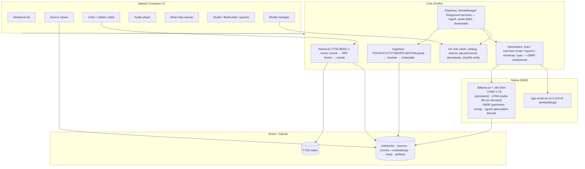
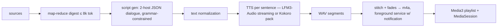
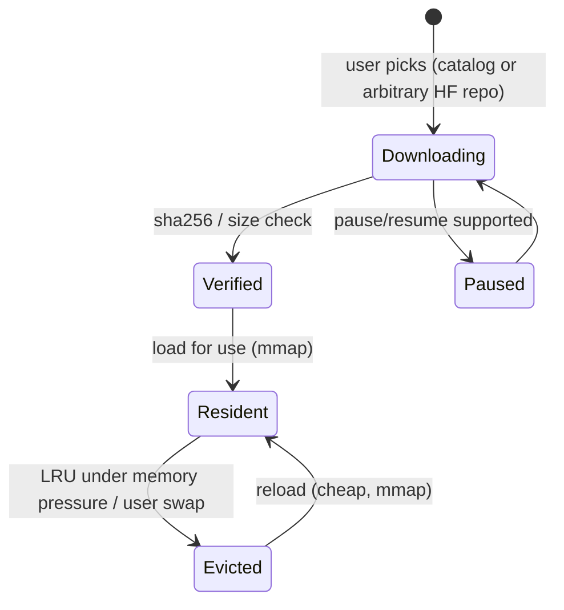

# PocketNotebook — Architecture

Target architecture. The scaffold (`:app`) is the seed; modules land as phases
progress (see [PLAN.md](PLAN.md)).

## System overview



## Audio overview pipeline (Phase 3)



## Data model (Room, Phase 1)

```
Notebook(id, title, createdAt)
Source(id, notebookId, type[pdf|text|md|html|epub|audio|url|pasted|ocr],
       title, filePath?, wordCount, status[pending|processing|ready|failed],
       addedAt)
Chunk(id, sourceId, ordinal, text, page?, paragraph?, embedding BLOB, tokens)
   -- FTS5 virtual table over Chunk(text) for BM25
ChatMessage(id, notebookId, role, content, citationJson?, createdAt)
Artifact(id, notebookId, kind[overview|report|mindmap|flashcards|quiz|note],
         status, payloadJson, audioPath?, createdAt)
ModelRecord(repoId, file, sizeBytes, sha256?, kind[chat|audio|embedding|tts],
            verified, installedAt)
```

Citations are `Chunk.id` references inside `citationJson` — provenance is a
first-class column, not a regex afterthought.

## Model lifecycle



- LFM3-1.7B: **persistent** residency (chat is the primary surface).
- LFM3-Audio-2B: **on-demand**, loaded by ingestion (ASR), audio bake (TTS),
  or interactive voice; evicted after idle timeout on low-RAM tiers.
- Embeddings model: tiny, loaded during ingestion only.

## Threading & services

- One dedicated generation thread per active model; JNI callbacks marshal to
  Kotlin `Flow` for token streaming.
- WorkManager jobs: `IngestWorker` (per source), `EmbedWorker`,
  `AudioBakeWorker`, `ModelDownloadWorker` (expedited + progress notification).
- Foreground services for: audio bake, ASR ingestion, audio overview playback
  (MediaSession).
- Thermal policy: `PowerManager.getCurrentThermalStatus()` polled during bakes;
  `SEVERE` → pause bake + notify; `MODERATE` → drop thread count.

## Target module layout (evolves from `:app`)

```
:app                     # shell, navigation, DI wiring
:core:database           # Room, FTS5, migrations
:core:models             # model manager, HF client, residency/LRU
:core:native             # JNI bindings, llama.cpp build (CMake), GBNF grammars
:core:ingestion          # extractors, chunker, embedder pipeline
:core:retrieval          # hybrid search, fusion, rerank
:feature:chat            # chat UI + citation engine
:feature:overview        # audio overview script/bake/play
:feature:studio          # reports, mind map, flashcards, quizzes
:feature:sources         # source viewer, importer UI
```

## JNI surface (draft — validated in Phase 0)

```kotlin
object PocketLlm {
    fun loadModel(path: String, kind: ModelKind, ctxLen: Int): Long   // handle
    fun unload(handle: Long)
    fun completeStream(handle: Long, prompt: String, grammar: String?,
                       params: GenParams): Flow<TokenEvent>
    fun embed(handle: Long, text: String): FloatArray
    // audio (LFM3-Audio-2B) — gate on Phase 0 findings:
    fun asrFile(handle: Long, wavPath: String, sysPrompt: String): String
    fun ttsToFile(handle: Long, text: String, voice: String, outWav: String)
    // future (interactive mode):
    fun voiceChatBegin(...): SessionHandle
    fun voiceChatFeed(session: Long, pcm: ShortArray)
    fun voiceChatStream(session: Long): Flow<AudioEvent>
}
```

## CI/CD

- **`android-ci.yml`** — every push/PR to `main`/`develop`: unit tests, lint,
  `assembleDebug`, APK artifact upload. Caching via `gradle/actions/setup-gradle`.
- **`release.yml`** — push a `v*` tag: tests, `assembleRelease` (signed if repo
  secrets set, debug-key fallback otherwise), APK attached to a GitHub Release
  with generated notes.
- Dependabot: weekly Gradle + Actions updates.
- Native (`llama.cpp`) build lands in Phase 1 as a CI job with NDK cache —
  the workflow already reserves room for it.
