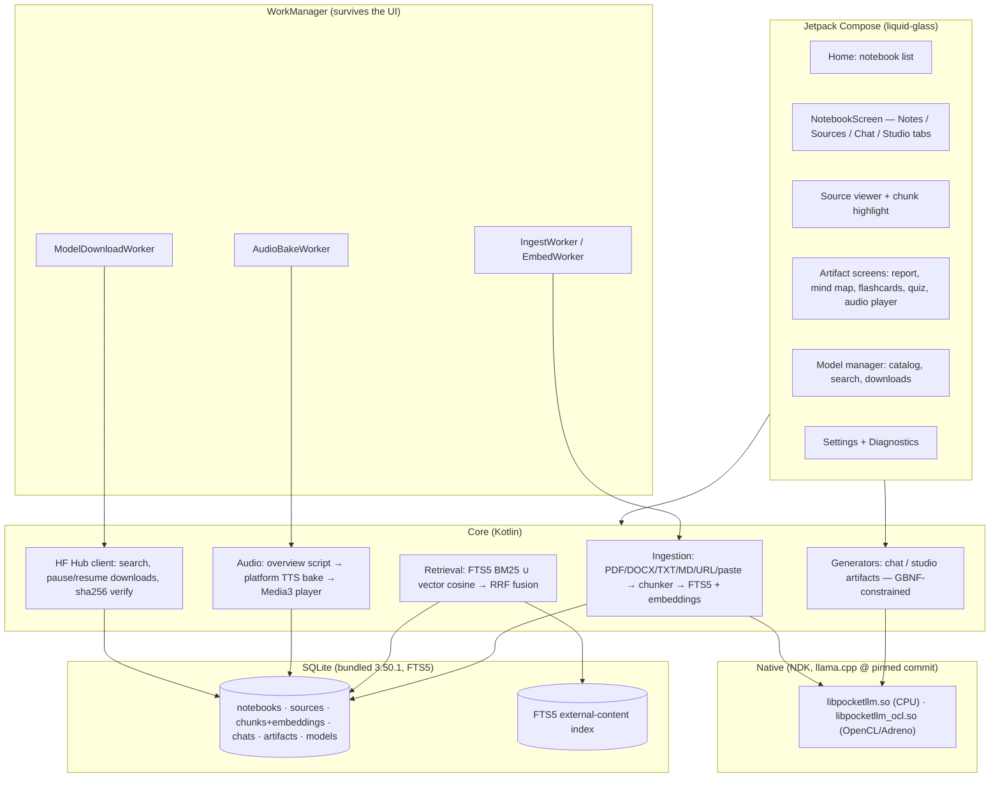
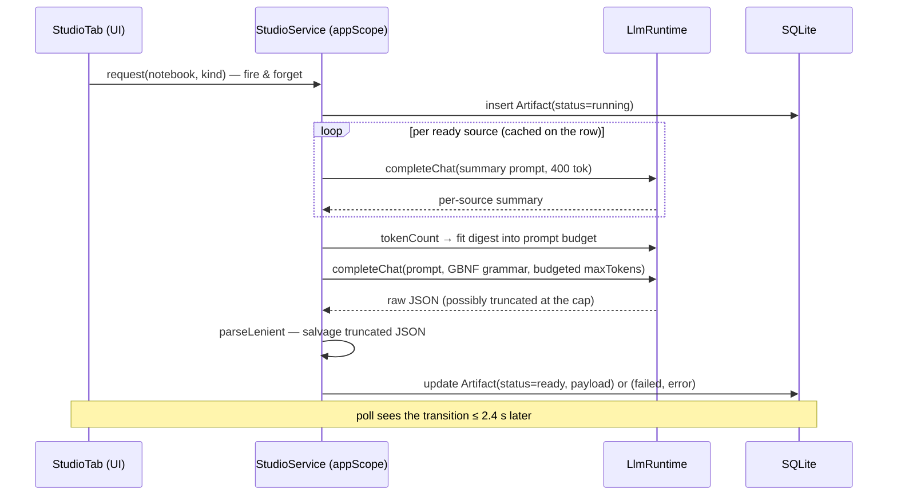
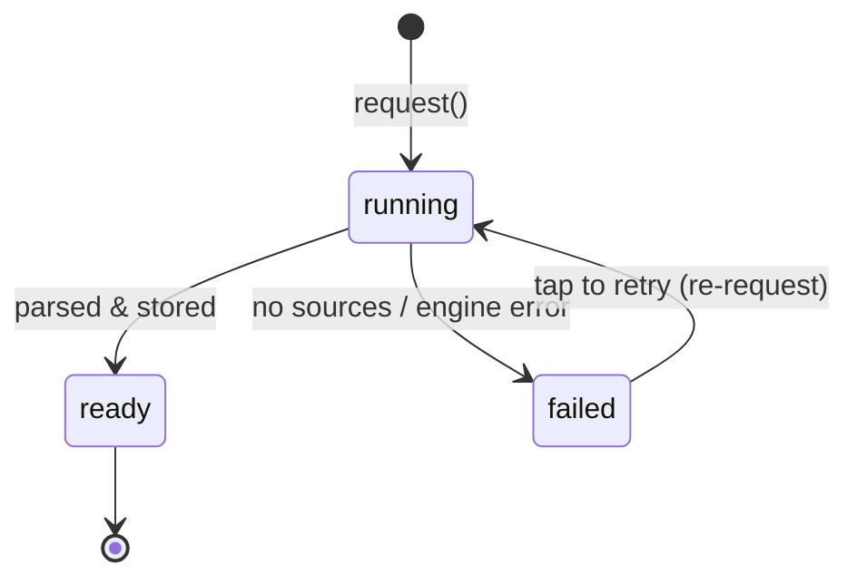
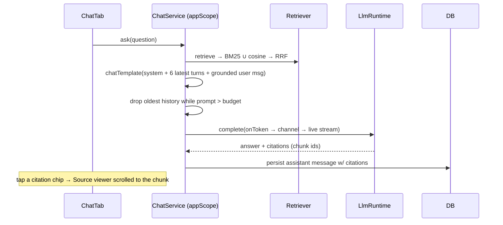
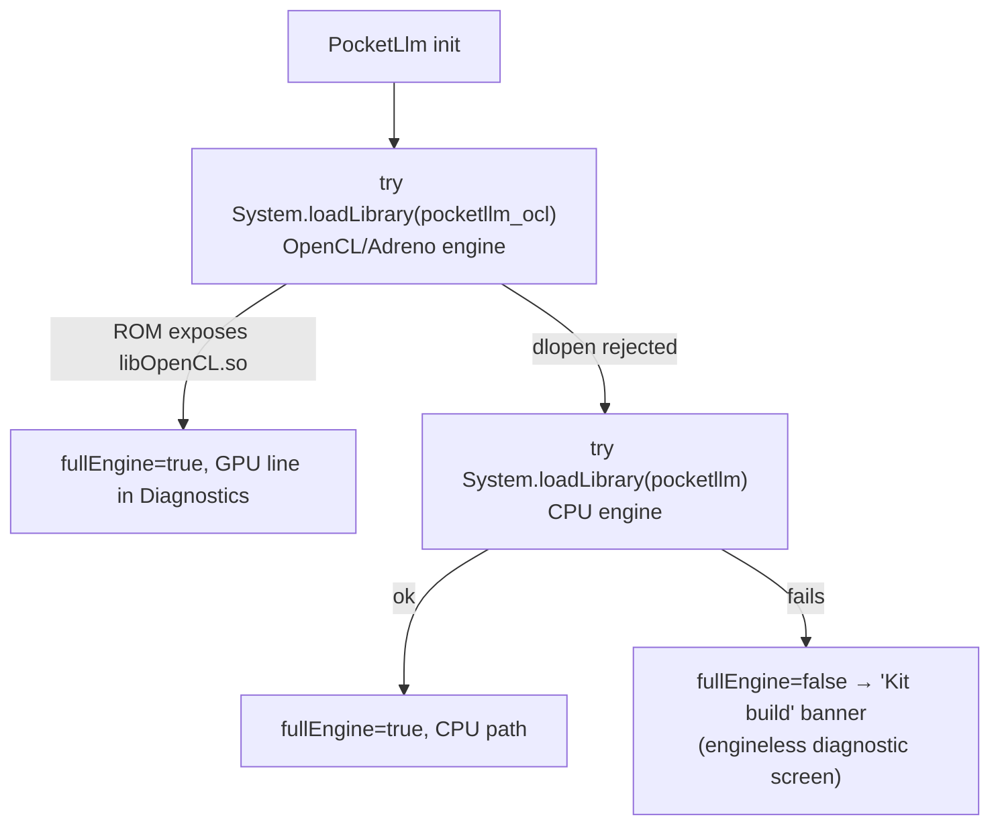
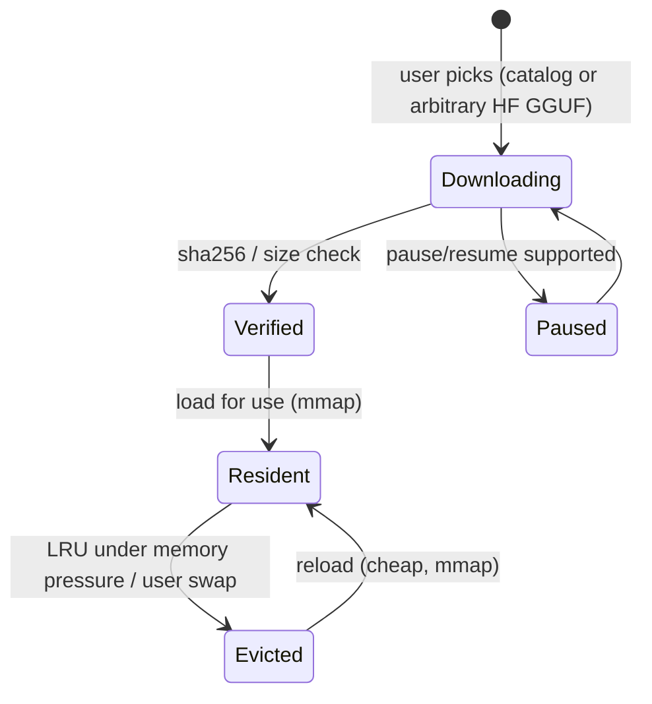

# PocketNotebook — Architecture

A local-first NotebookLM clone for Android: ingestion → grounded chat →
studio artifacts → audio overviews, 100 % on-device. This document describes
the **shipped** architecture (v0.1.0-alpha) with the target state marked
where it still differs (see [PLAN.md](PLAN.md) for the roadmap).

## System overview



## Navigation map (shipped)

```mermaid
flowchart LR
    ONB[Onboarding<br/>(first-run model download)] --> HOME
    HOME -->|open notebook| NTBK[NotebookScreen<br/>Notes · Sources · Chat · Studio]
    NTBK -->|open chunk| SV[Source viewer]
    NTBK -->|open artifact| ART[Artifact screens:<br/>report · mind map · flashcards · quiz · audio player]
    NTBK --> MODELS[Model manager]
    NTBK --> SETTINGS[Settings]
    SETTINGS --> DIAG[Diagnostics<br/>engine lib · GPU · context]
```

`AppRoot` hosts a single Compose `NavHost` with routes
`onboarding · home · notebook/{id} · source/{id}?chunk= · artifact/{id} ·
models · settings · diagnostics`.

## Coroutine scope ownership — the load-bearing rule

**Work that must finish must never live in a composable's scope.**
`rememberCoroutineScope()` is cancelled the instant its composable leaves
composition. In alpha.11 the studio generators ran there: leaving the Studio
tab mid-generation aborted the whole artifact, which then surfaced as a
failure card reading *"coroutine scope left the composition"*. Fixed in
alpha.12 by moving all generation work onto an app-lifetime scope.

```mermaid
flowchart TB
    subgraph COMPOSE["Composition scopes (die with the UI)"]
        LE[LaunchedEffect — polling, one-shot warmup]
        RCS[rememberCoroutineScope — transient UI only:<br/>search calls, chip refresh, snackbar]
    end
    subgraph APPSCOPE["AppContainer.appScope<br/>SupervisorJob + Dispatchers.Default"]
        GEN[Studio artifact generation<br/>request → generateX]
        CHAT[Chat ask + streaming]
        LOAD[Model (re)load ensureChatLoaded]
    end
    subgraph WMS["WorkManager foreground workers"]
        ING[Ingest / Embed]
        BAKE[Audio bake]
        DL[Model download]
    end
    UI_CLICK[UI tap] -->|fire & forget| GEN
    GEN --> DB[(SQLite)]
    CHAT --> DB
    LE -.observes.-> DB
```

| Scope | Owner | Used for | Lifetime |
|---|---|---|---|
| `appScope` | `AppContainer` | studio generations, chat answers, model loads | process |
| Worker scopes | WorkManager | ingestion, baking, downloads | OS-managed |
| `rememberCoroutineScope` | a composable | transient UI actions (search, refresh) | composable |
| `LaunchedEffect` | a composable | tab-local polling/warm-up while visible | composable |

Rules enforced since alpha.12:

1. `StudioService.request()` is the **only** UI entry into generators; it
   launches on `appScope` so artifacts finish even if the user leaves the
   tab, opens another screen, or backgrounds the app.
2. `CancellationException` is **rethrown** everywhere, never recorded as a
   user-visible failure — cancellation is not an error.
3. `LlmRuntime.ensureChatLoaded()` resets `chatLoading` in a `catch` clause
   *before* rethrowing, so a cancelled load can never leave the UI stuck on
   “Loading model…”.
4. The UI learns about generation progress by polling the artifact table
   (unconditionally, every 1.2 s while the Studio tab is visible) — the DB is
   the single source of truth, which is exactly what makes fire-and-forget
   safe.

## Studio generation pipeline



Artifact status state machine:



Token budgets are per artifact kind (`REPORT_TOKENS`…`OVERVIEW_TOKENS`) and
the digest is trimmed to `ctx − maxTokens − 640` so the demanded output always
fits `n_ctx` (alpha.9's Deep Dive/Flashcards failures were exactly this).

## Grounded chat pipeline



Reasoning/thinking text is stripped both from streamed tokens and from
completed text (`Thinking.strip`), and the chat template opens the assistant
turn with thinking disabled.

## Engine layer & GPU fallback

Two engines ship, in **one APK each**; inside the app the choice is a
dlopen fallback:



- The **standard APK** carries only `libpocketllm.so` (loads everywhere).
- The **experimental `-gpu` APK** carries the OpenCL engine **plus** the CPU
  engine staged next to it — ROMs that don't expose `libOpenCL.so` to apps
  silently fall back to the CPU engine instead of running engineless.
- 16 KB page alignment is a hard gate in CI: newer Xiaomi/Android 15+ ROMs
  refuse 4 KB-aligned native libs (`scripts/check_16k_alignment.py`).

## JNI surface (actual, shipped)

```kotlin
object PocketLlm {
    // engine + fallback: pocketllm_ocl → pocketllm → kit (engineless) mode
    val fullEngine: Boolean;  val engineIssue: String?;  fun gpuInfo(): String

    // model lifecycle
    external fun nativeLoadModel(path, ctxLen, threads, isEmbed, kvQuant): Long // handle
    external fun nativeUnload(id: Long)
    fun meta(id: Long): Meta?            // ctx size, model name, …

    // prompting
    external fun nativeApplyTemplate(id, roles[], contents[], addAssist): String
    external fun nativeTokenCount(id, text): Int
    external fun nativeCtx(id): Int

    // generation — blocking; tokens surface via the static bridge
    fun completeBlocking(id, prompt, grammar, grammarRoot,
                         temp, topK, topP, seed, maxTokens, stop, onToken): String
    external fun nativeAbort(id)                     // abort_callback → UI Stop
    fun emitToken(id, piece)  // static JNI callback → channel → UI stream
    fun onDone(id)

    // embeddings (bge-small)
    external fun nativeEmbed(id, text): FloatArray
}
```

GBNF grammars constrain mind map / flashcards / quiz / overview-script
outputs to valid JSON roots; `StudioJson.parseLenient` then salvages
truncated output into a smaller-but-valid artifact instead of failing.

## Data model (SQLite v1 — bundled engine)

> **Bundled engine**: `androidx.sqlite:sqlite-bundled` (SQLite 3.50.1, FTS5
> compiled in, 16 KB-page aligned). The system SQLite omits FTS5 on every
> vendor — v0.1.0-alpha.2 failed at first launch with `no such module:
> fts5`. One FULLMUTEX connection shared app-wide; `DbSchemaFts5Test` replays
> the real DDL against an FTS5 engine in CI.

```
Notebook(id, title, createdAt)
Source(id, notebookId, type[pdf|text|md|html|epub|audio|url|pasted|ocr],
       title, filePath?, wordCount, status[pending|processing|ready|failed],
       summary?, error?, addedAt)
Chunk(id, sourceId, ordinal, text, page?, paragraph?, embedding BLOB, tokens)
   -- FTS5 virtual table over Chunk(text) for BM25
ChatMessage(id, notebookId, role, content, citationJson?, createdAt)
Artifact(id, notebookId, kind[study_guide|briefing|faq|timeline|mindmap|
         flashcards|quiz|overview|report…], status, payloadJson,
         audioPath?, error?, createdAt)
ModelRecord(repoId, file, sizeBytes, sha256?, kind[chat|audio|embedding|tts],
            verified, installedAt)
```

Citations are `Chunk.id` references inside `citationJson` — provenance is a
first-class column, not a regex afterthought.

## Model lifecycle



- Chat model (LFM3-1.7B class): **persistent** residency, reloaded lazily by
  `ensureChatLoaded()` on any generation path.
- Embeddings model: tiny, loaded during ingestion/retrieval only.
- Models are never bundled in the APK; first-run onboarding downloads them.

## Threading & services

- **One completion at a time** (`genMutex`): mobile KV-cache + RAM reality.
  Tokens stream from native through `PocketLlm.emitToken` into a channel; the
  UI collects it live in chat.
- **Abort**: `llama_context_params.abort_callback` → `PocketLlm.nativeAbort`.
- **WorkManager** workers own ingestion, embedding, audio bake and model
  downloads — they survive the UI and keep the `appScope` lean.
- **Thermal policy**: `PowerManager.getCurrentThermalStatus()` polled during
  bakes; `SEVERE` → pause bake + notify; `MODERATE` → drop thread count.
- Thread count defaults to `cores.coerceIn(2, 8)`; user-overridable in
  Settings.

## Release pipeline

```mermaid
flowchart LR
    subgraph EVERY_PUSH[android-ci.yml — every push]
        KIT[kit build -PskipNative=true<br/>tests · lint · stub APK]
    end
    subgraph MAIN[native.yml — push to main]
        NA[full native build (arm64)<br/>+ 16 KB gate + artifact]
    end
    subgraph TAG[release.yml — push tag v*]
        T1[unit tests] --> T2[CPU APK assembleRelease]
        T2 --> T3[16 KB gate]
        T3 --> T4[stage CPU lib]
        T4 --> T5[GPU APK = OpenCL lib + CPU lib]
        T5 --> T6[16 KB gate]
        T6 --> REL[GitHub Release:<br/>arm64.apk + arm64-gpu.apk + checksums]
    end
```

- `versionCode` = CI run number, `versionName` = the tag.
- Signing: repo secrets → committed sideload keystore → debug key (priority
  order, details in [BUILD.md](BUILD.md)).
- Both APKs share one signature — they install right over each other.

## Target module layout (evolves from `:app`)

Today everything lives in `:app` with strict package boundaries
(`core.db / core.llm / core.engine / core.ingest / core.retrieval /
core.audio / core.work / ui`). Gradle modules land as the codebase grows:

```
:app                     # shell, navigation, DI wiring (today)
:core:database           # SQLite+FTS5, migrations
:core:native             # JNI bindings, llama.cpp build (CMake), grammars
:core:ingestion          # extractors, chunker, embedder pipeline
:core:retrieval          # hybrid search, fusion, rerank
:feature:chat            # chat UI + citation engine
:feature:overview        # audio overview script/bake/play
:feature:studio          # reports, mind map, flashcards, quizzes
```
